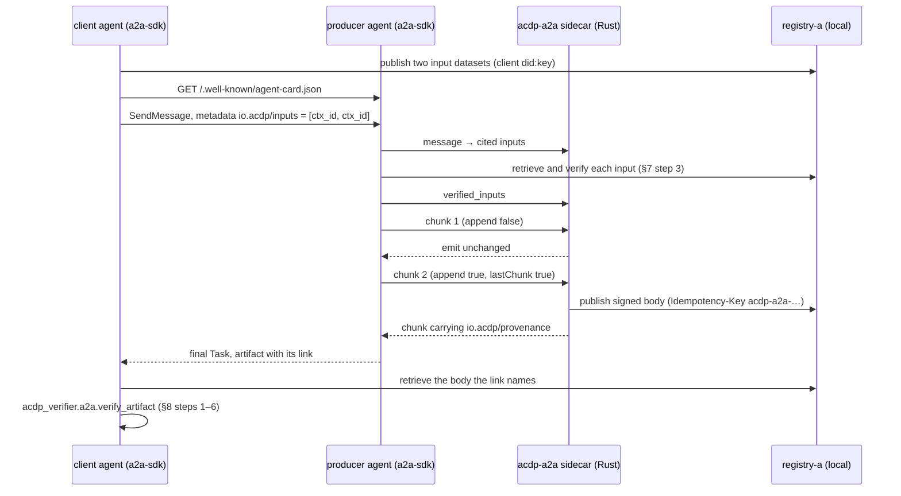

# A2A artifact provenance demo (RFC-ACDP-0022)

Two agents built on the official [A2A Python SDK](https://github.com/a2aproject/a2a-python) (`a2a-sdk` 1.3.0, A2A protocol 1.0) show [RFC-ACDP-0022](https://github.com/agentcontextdistributionprotocol/agentcontextdistributionprotocol/blob/main/rfcs/RFC-ACDP-0022-a2a-artifact-provenance.md) end to end against a local ACDP registry:

- The **producer agent** signs each artifact it completes as an ACDP body under its own `did:key`. It returns the link in `Artifact.metadata["io.acdp/provenance"]`.
- The **client agent** calls the producer, then verifies what it holds, as RFC-0022 §8 describes.

The signature proves authorship only: *this key published exactly these parts*. It does not mean anyone accepted the result.

This demo is a separate project. The deployed playground app does not import it, install it or ship it, because the image build ignores `a2a/`.

## Use only existing implementations

The demo has no RFC-0022 logic of its own. Each side runs code that already exists:

| Side | Implementation |
|---|---|
| Producer: assembly, the salted `acdp-a2a-artifact/1` record, signing, publishing before the final chunk, `Idempotency-Key`, the link, fail-open, and the Card entry | acdp-rs [`acdp-a2a`](https://github.com/agentcontextdistributionprotocol/acdp-rs/tree/main/crates/acdp-a2a), driven through [`sidecar/`](sidecar/src/main.rs) |
| Holder: steps 1–5 of §8, and step 6 (status) | acdp-verifier-py [`acdp_verifier.a2a`](https://github.com/agentcontextdistributionprotocol/acdp-verifier-py/blob/main/acdp_verifier/a2a.py): `verify_artifact` and `artifact_status` |
| Verifying the cited inputs (§7 step 3), and signing the retraction event (RFC-ACDP-0013) | the `acdp` wheel from PyPI, through the playground's `acdp_client` and its `mint_lifecycle_event` helper |
| A2A server, client and Agent Card | `a2a-sdk` |

The `acdp` Python wheel has no A2A surface, so the producer cannot call `acdp-a2a` directly. Instead, `sidecar/` is a small Rust binary that speaks JSON over stdin and stdout. Its whole job is to pass the agent's A2A JSON to `acdp_a2a::Agent::on_chunk` and `TaskSession`, and to pass back the chunk to emit.



## Run it

You need Docker, a Rust toolchain and `uv`.

```bash
cd a2a
make dev      # build the sidecar and install a2a-sdk, acdp and acdp-verifier
make up       # registry-a (the playground's config/registry-a.toml) on :8100
make demo     # the three runs
make down
```

`make up` uses the published `acdp-registry` image with a throwaway Postgres, so you need no sibling checkout of `acdp-registry-rs`. If the root stack is already running (`make up` at the repo root), skip `make up` here: the demo targets `http://localhost:8100` either way.

The demo refuses any registry that is not on loopback. Demo bodies are throwaway, so never publish them to a production registry.

## The three runs

Each run starts a new A2A task. The client cites two sensor datasets that it published itself. The producer verifies them and summarizes them into one artifact, sent as two chunks: a text part, then a data part with the statistics.

1. **pass.** The artifact the client holds verifies. The checks cover:
   - the body;
   - the Card's `agentId`, which must equal `agent_id`;
   - the closed record and the salt;
   - `parts_hash`, `artifact_id_hash`, the name, and the task and context id hashes;
   - the status: not retracted, not superseded.

   The body's `derived_from` lists the two cited inputs in order.
2. **tamper.** An on-path rewrite of the agent's HTTP response changes one text Part. The holder fails at §8 step 4 with `parts_mismatch`, and reports the recomputed and recorded `parts_hash`. The body itself is still validly signed. It is simply not a record of the content the client now holds.
3. **retraction.** The artifact verifies, with `retraction=not_retracted`. The producer then retracts its own body with a signed RFC-0013 lifecycle event. Later, the holder re-checks the status by retrieval and gets `retraction=retracted`. acdp-verifier-py checks the producer's signature on the event and its `ctx_id` binding again before counting it. Nothing is pushed to the client: it only learns of the retraction because it checks again (§8 step 6, §11).

Sample output (the DIDs, ids and hashes change every run):

```text
[1/3] pass: the held artifact verifies
    card agentId           did:key:z6MkhQphRGaoPrQ4kPaBwaDsu3Tfz1Mie4fb8p2NecE9i7NZ
    artifact text          Summarize the cited readings: 7 readings from north-inlet, south-inlet; mean 21.6 celsius (min 20.9, max 22.4), trend rising.
    link ctx_id            acdp://registry-a.playground.local/bfd2e3ab-56d3-49cc-a6eb-5561d70dfc91
    verdict                verified (all §8 checks passed)
    record                 acdp-a2a-artifact/1 salted=True embedded=False a2a=1.0
    checks                 card=True task=True context=True
    status                 retraction=not_retracted superseded=False
  => PASS

[2/3] tamper: one Part changed in transit
    verdict                step 4 parts_mismatch
    detail                 §8 step 4 (parts_mismatch): parts_hash: recomputed sha256:0386c9…, record has sha256:508d7b…
  => PASS (rejected at parts_hash, as expected)

[3/3] retraction: the producer retracts, the holder re-checks
    verdict (before)       verified, retraction=not_retracted
    producer retracted     {'ctx_id': 'acdp://registry-a.playground.local/2235c436-…', 'status': 'retracted', …}
    re-check (retrieval)   retraction=retracted superseded=False
  => PASS
```

`--json PATH` writes the outcome record. CI uploads it as the `a2a-demo-outcome` artifact.

## Local relaxations

These relaxations apply only to the local stack. Each one is a place where production behaviour differs:

- **Plain http on loopback.** The sidecar's `RegistryClient` uses a relaxed SSRF policy (`allow_http`, loopback), but only when `allow_local_http` is set. The client fetches through an explicit allowlist that maps `registry-a.playground.local` to `http://localhost:8100`. RFC-0022 §9 requires HTTPS for every holder fetch, and blocks loopback and private addresses.
- **Inputs verified with the wheel, not the cross-registry resolver.** The registry's `did:web:registry-a.playground.local` is not hosted on the web, so acdp-rs's `CrossRegistryResolver`, which checks that binding, cannot run here. The producer verifies each cited `did:key` input with `AcdpVerifier.verify_body_offline` instead, and passes the verified ids through `TaskSession::mark_inputs_verified`.
- **Public bodies.** §13.3 recommends `private` or `restricted` visibility. The local registry serves anonymous holders only `public` bodies, so the demo publishes public bodies, which are throwaway.
- **A trust anchor passed out of band.** The holder trusts the producer's DID because the demo passes it directly. The holder never takes it from the Card. The Card is only a pointer that gets cross-checked (§9).
- **Retraction route.** The producer exposes `POST /demo/retract`, for the demo only. Through it, the agent withdraws one of its own bodies.

## Out of scope

The demo follows the boundary in RFC-0022 §11. It has:

- no reliance ledger;
- no acceptance or approval state;
- no per-task receipts;
- no recall pushed into tasks.

Lifecycle runs only through RFC-ACDP-0013 retraction. The holder learns of it by pulling status again.

## Layout

| Path | What |
|---|---|
| `acdp_a2a_demo/producer.py` | The A2A server, the executor, the Card, input verification, and the retraction route |
| `acdp_a2a_demo/client.py` | The A2A client, the tampering transport, and the holder (allowlist, retrieval, evidence packaging) |
| `acdp_a2a_demo/demo.py` | The three runs |
| `acdp_a2a_demo/sidecar.py` | The async client for the sidecar |
| `sidecar/` | The Rust bridge to `acdp-a2a`, pinned to acdp-rs `4e99bfe` until `acdp-a2a` is on crates.io |
| `docker-compose.yml` | Local registry-a, plus Postgres for the published image |
| `tests/` | Offline checks: the sidecar's identity and Card, pass-through, fail-open, and the holder's guards |
